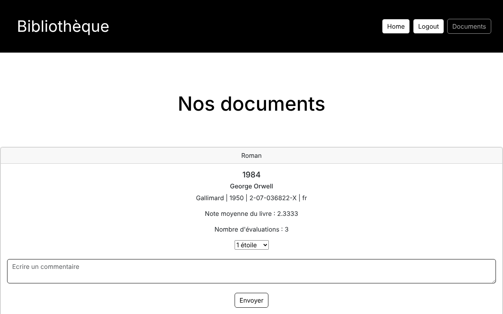
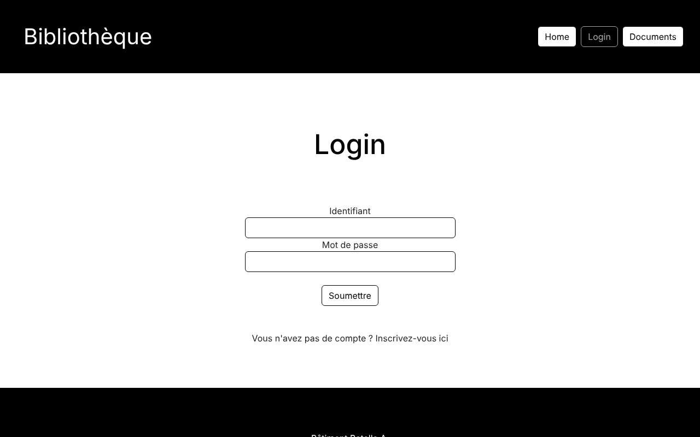
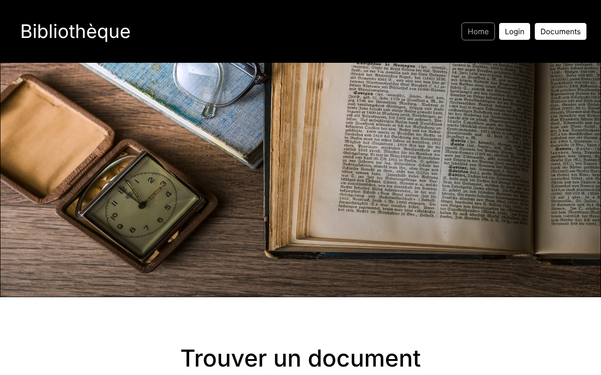

# Mini Projet NTIC (TP5) : Bibliothèque en Ligne

Petit site web de bibliothèque développé en **PHP** avec une base de données **MySQL**. Les visiteurs peuvent consulter le catalogue de livres. Une fois inscrits et connectés, ils peuvent aussi noter chaque livre et laisser un commentaire. La note moyenne et le nombre d'évaluations de chaque livre s'affichent dans le catalogue.
Réalisé dans le cadre du cours Nouvelles Technologies d'Information et de Communication à l'Université de Genève, Printemps 2023. 

## Utilisation

- **Documents** : consulter le catalogue.
- **Login** : se connecter avec un compte de démonstration, par exemple, `anna.dupont@gmail.com` / `abccc1234`, ou créer un compte via « Inscrivez-vous ici ».
- Une fois connecté, aller dans **Documents**, choisir une note et écrire un commentaire, puis cliquer sur **Envoyer**.
